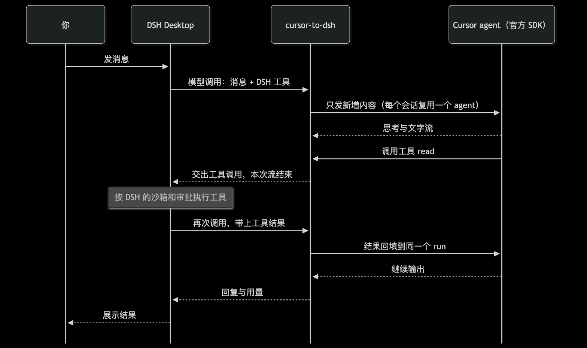

# cursor-to-dsh

[](https://www.npmjs.com/package/cursor-to-dsh)
[](LICENSE)

> Use Cursor models as the `cursor` LLM provider in DeepSeek Harness (DSH) and DeepSeek Desktop, through the official `@cursor/sdk` and your own Cursor API key. DSH keeps the agent loop, tools and permissions; Cursor is only the model. The docs are in Chinese.

把 Cursor 注册为 [DeepSeek Harness](https://github.com/deepseek-ai/deepseek-harness)（DSH，含 DeepSeek Desktop）的模型提供方 `cursor`。DSH 负责 agent 循环、工具和权限，Cursor 只当模型。



## 特点

- **官方接口**：通过 `ctx.llm.registerAdapter` 注册适配器，不改 DSH 内部实现。
- **缓存复用**：每个 DSH 会话对应一个 Cursor agent，只发新增内容；工具结果回填到同一个 run 里继续。
- **工具归 DSH**：Cursor 内置工具关闭，工具全部由 DSH 执行，受 DSH 的沙箱和审批管控。
- **模型参数**：模型目录和推理强度来自 Cursor 的实时目录；始终 `fast=false`；上下文档位默认最小档，被拒时自动降档。
- **用量口径**：按 DSH 的互不重叠用量桶上报，多次调用的 run 按估算上下文上报，不误报超限。
- **图片**：用户消息和工具结果里的图片附件从 DSH 附件服务读出后转给 Cursor，同一附件只读一次。

## 安全合规

- **官方 SDK + 自己的 key**：只通过 Cursor 官方 `@cursor/sdk` 调用，用你在 Cursor 后台创建的 API Key，用量计入你自己的 Cursor 账号；不逆向私有协议，不读取 Cursor IDE 的登录态或本地凭据。
- **DSH 官方接口**：通过 `ctx.llm.registerAdapter` 注册，不改宿主代码。
- **工具与权限归 DSH**：Cursor 内置工具全部关闭，读写文件、执行命令都由 DSH 执行，沿用 DSH 的沙箱和审批。
- **key 不外泄**：key 存在 DSH 凭据服务（`~/.dsh/.credentials.yaml`，`0600`）或环境变量里，不写进日志、不进仓库。

## 原理

- 适配器把 DSH 的请求消息转成核心逻辑的形状，按消息指纹判断 Cursor 已经看过哪些内容。
- DSH 的工具挂给 Cursor 作为自定义工具。Cursor 调工具时，适配器交出工具调用并结束本次流；DSH 执行完工具再调一次适配器，结果回填后同一个 run 继续。
- 会话中途新增的工具会在下一次发送里告知模型（Cursor 只在会话开始时列出工具）。
- 压缩、改写历史、换模型、系统提示词被改写时，新开 Cursor agent 并重放完整历史。标题、压缩等辅助调用用一次性 agent。

## 安装

前置：DSH `0.2.0-rc.2` 及以上（DeepSeek Desktop 内置 `0.2.1-rc.2`）。

Desktop 用 `desktop` profile，它只归 Desktop 管：`dsh plugin --profile desktop add` 和 `--dump-config` 都会报 `managed exclusively by the Electron application`。所以要先退出 Desktop，手动改 profile 的 `package.json`，再用 Desktop 自带的 pnpm 安装。

1. 完全退出 DeepSeek Harness Desktop。
2. 编辑 `~/.dsh/profiles/desktop/package.json`，保留已有条目，只加两处：

   ```json
   {
     "dependencies": {
       "cursor-to-dsh": "^0.1.1"
     },
     "dsh": {
       "profile": {
         "bundles": ["…已有条目…", "cursor-to-dsh"]
       }
     }
   }
   ```

3. 按下文「获取 key」写好 `CURSOR_API_KEY`，然后安装并启动 Desktop：

   ```bash
   cd ~/.dsh/profiles/desktop
   node "/Applications/DeepSeek Harness.app/Contents/Resources/runtime/primary-runtime/dependencies/pnpm/bin/pnpm.mjs" install
   open -a "DeepSeek Harness"
   ```

4. Desktop「设置 → 模型」里出现 Cursor、模型选择里有 `cursor` 下的模型，即安装成功。

其他 profile（如 CLI 的默认 profile）不受限制，可以直接 `dsh plugin --profile <名称> add cursor-to-dsh`。升级：改版本号后重复第 3 步。

从源码安装（开发用）：`git clone https://github.com/lukeinx/cursor-to-dsh.git && cd cursor-to-dsh && npm install && npm run build`，第 2 步的依赖写成 `"cursor-to-dsh": "link:<仓库绝对路径>"`。源码改动后要重新 `npm run build` 并重启 DSH。

也可以把下面这段发给 Agent（Claude Code、Cursor、pi 等）代装：

```text
按 https://github.com/lukeinx/cursor-to-dsh 的 README 给我的 DeepSeek Harness Desktop 安装 cursor-to-dsh，
遵守 README 里给 Agent 的规则；装好后告诉我把 Cursor API Key 填到哪里，key 由我自己填。
```

让 coding agent 代装时，请它遵守：改 profile 前先退出 Desktop，只追加条目、不动已有的 `dependencies` 和 `bundles`；key 由用户自己填入凭据文件，Agent 不读取、不打印；在本仓库改代码前先读 [AGENTS.md](AGENTS.md)。

获取 key：打开 [cursor.com/dashboard](https://cursor.com/dashboard) → API Keys → New API Key。用个人 key 或 service account key，Team Admin key 不支持。

Key 的查找顺序：DSH 凭据服务里的 `CURSOR_API_KEY` → 启动 DSH 时的环境变量 `CURSOR_API_KEY` → 插件配置 `apiKey`。

Desktop「模型」设置页目前只给内置 provider 显示 key 输入框，第三方插件填不了。推荐写进 DSH 的本地凭据文件 `~/.dsh/.credentials.yaml`，权限必须是 `0600`，改动会热加载，优先级高于环境变量：

```yaml
version: 1
refs:
  CURSOR_API_KEY: <你的 key>
```

文件已存在时只在 `refs:` 下加一行，不要覆盖已有条目。也可以在 profile 的 `cordis.patch.yml` 里覆盖插件这一行，直接写 `apiKey`（明文在配置里，不推荐）：

```yaml
- id: llm-cursor
  name: cursor-to-dsh
  config:
    apiKeyEnv: CURSOR_API_KEY
    apiKey: <你的 key>
    context: min
```

patch 会替换整个 `config`，覆盖时要写全所有键。然后在模型选择里选 `cursor` 下的模型，或者把 `agent-default-model` 改成 `provider: cursor`。

## 配置

| 配置项 | 默认值 | 含义 |
|---|---|---|
| `apiKeyEnv` | `CURSOR_API_KEY` | 存 key 的凭据名 / 环境变量名 |
| `apiKey` | 无 | 凭据和环境变量都没有时使用 |
| `context` | `min` | 上下文档位：`min`、`max` 或具体档位如 `300k` |
| `cwd` | 会话工作目录 | Cursor agent 的工作目录 |

环境变量：`DSH_CURSOR_CONTEXT` 覆盖 `context`，`DSH_CURSOR_CWD` 覆盖 `cwd`，`DSH_CURSOR_DEBUG=1` 输出调试日志（含建 agent、发送、首个事件的耗时）到 stderr，`DSH_CURSOR_PREWARM=0` 关闭预热。

预热：Cursor SDK 每个进程第一次建 agent 要约 8 秒初始化。插件加载后拿到 key 就拉模型目录，成功后在后台建一个一次性 agent 把这段时间提前付掉（在空临时目录里，发送后立即取消）。之后每个新会话的首字时间主要是模型本身：Haiku 5.5 开思考约 3 秒、关思考约 1.3 秒；Sonnet 5.5 约 1.2 秒；DSH 的工具和系统提示词较长时还会再慢一些。

## 已知限制

- 文件附件、已被卸载（offloaded）的图片和读不出的图片不转给 Cursor，只留一句占位说明。重放历史时只带最后一条用户消息的图片，更早的图片 Cursor 看不到。
- 工具交接时不报用量（Cursor 只在 run 结束时给累计值），上下文用量在 run 结束时更新。
- `stop` 停止序列不支持，请求带了会报 `UNSUPPORTED_OPTION`；`temperature`、`maxTokens` 被忽略。
- 「模型」设置页会列出 Cursor 并显示 key 是否已配置，但宿主只给内置 provider 渲染编辑表单，Cursor 这一行不能在页面上填 key 或改配置。

## 开发

```bash
npm test         # 假 Cursor agent 的单测
npm run check    # 类型检查
npm run build    # 生成 lib/，DSH 加载的是它
npm run check:public   # 发布前检查：不含内网链接、本机路径，package.json 指向公开仓库
CURSOR_API_KEY=... node --experimental-strip-types scripts/live.ts [模型 id]   # 真实 Cursor 实测
```

不安装、不动任何 profile，在真实 DSH 里试跑：写一个 overlay（路径必须是绝对路径），用 headless 模式执行一个任务。

```yaml
# /tmp/cursor-overlay.yml
- insert:
    - id: llm-cursor
      name: <仓库绝对路径>/lib/index.js
- id: agent-default-model
  name: '@deepseek-ai/dsh-agent-default-model'
  config:
    provider: cursor
    model: claude-haiku-5-5
```

```bash
DSH="/Applications/DeepSeek Harness.app/Contents/Resources/runtime/cli/bin/dsh"
CURSOR_API_KEY=... DSH_CURSOR_DEBUG=1 "$DSH" --profile headless --patch /tmp/cursor-overlay.yml --json "Read README.md and summarize it in one line"
```

`--json` 输出运行事件；调试日志里工具结果回填那次调用应显示 `plan=results`（同一个 Cursor run 继续）。

`--patch` 按绝对路径挂载时，插件用的是自己 `node_modules` 里的 `@deepseek-ai/dsh-llm` 副本，和宿主不是同一份，`LlmError` 的错误码在 agent 循环里会变成 `UNKNOWN`。只用于试跑；正式使用请 `dsh plugin add`，那样共享宿主的副本。

同一进程多轮对话可以用 npm 上的 `@deepseek-ai/dsh-sdk-client` 驱动 `dsh --profile sdk`，`patches` 传同一个 overlay；第二轮调试日志应显示 `plan=send`（只发新增内容）。

约束见 [AGENTS.md](AGENTS.md)。

## 版权

MIT，见 [LICENSE](LICENSE)。Copyright (c) 2026 Luke。
