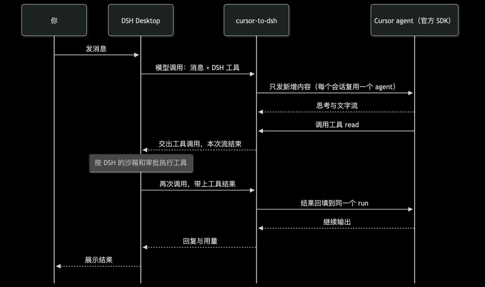

# cursor-to-dsh

[](https://www.npmjs.com/package/cursor-to-dsh)
[](LICENSE)

> Use Cursor models as the `cursor` LLM provider in DeepSeek Harness (DSH) and DeepSeek Desktop, through the official `@cursor/sdk` and your own Cursor API key. DSH keeps the agent loop, tools and permissions; Cursor is only the model. The docs are in Chinese.

把 Cursor 注册为 [DeepSeek Harness](https://github.com/deepseek-ai/deepseek-harness)（DSH，含 DeepSeek Desktop）的模型提供方 `cursor`。DSH 负责 agent 循环、工具和权限，Cursor 只当模型。



## 特点

- **官方接口**：只用 Cursor 官方 `@cursor/sdk` 和你自己的 API Key，不逆向私有协议、不读 Cursor IDE 登录态；通过 DSH 的 `ctx.llm.registerAdapter` 注册，不改宿主代码。
- **装好就能用**：浏览器半侧在「设置 → 模型」的 Cursor 行里放一个 API 密钥卡片，粘贴保存即可。密钥经 DSH 的凭据服务写入本机凭据，不进 `cordis.patch.yml`；无 Web 界面的 profile 才需要自己写文件或环境变量。
- **工具归 DSH**：Cursor 内置工具全部关闭，读写文件、执行命令都由 DSH 执行，沿用 DSH 的沙箱和审批。
- **缓存复用**：每个 DSH 会话对应一个 Cursor agent，只发新增内容；工具结果回填到同一个 run 继续。
- **模型与用量**：模型和推理强度来自 Cursor 实时目录，始终 `fast=false`；按 DSH 互不重叠的用量桶上报，不误报超限。
- **图片**：用户消息和工具结果里的图片转给 Cursor。

## 安装

前置：DSH `0.2.0-rc.2` 及以上（DeepSeek Desktop 内置 `0.2.2-rc.3`）。

**DeepSeek Desktop / Web**：侧栏**插件** → **添加插件**，填包名 `cursor-to-dsh`，安装完成后点**立即启用**。装完「设置 → 模型」里多出 Cursor 一行。

**CLI 或其他 profile**：`dsh plugin --profile <名称> add cursor-to-dsh`。

升级同样在**插件**页进行：卸载后重新添加 `cursor-to-dsh`（CLI profile 用 `dsh plugin add cursor-to-dsh@latest`）。

### 填 API Key

1. 在 [cursor.com/dashboard](https://cursor.com/dashboard) → API Keys → New API Key 创建（个人 key 或 service account key，不支持 Team Admin key）。
2. 打开**设置 → 模型**，在 Cursor 那一行的 **API Key** 输入框里粘贴，按回车或点**保存**。
3. 输入框收起为一行绿色「已保存」，模型列表随之刷新；**更换**可重新输入（Esc 取消），**清除**会删除这条凭据。

密钥只写入本机凭据（`~/.dsh/.credentials.yaml` 的 `CURSOR_API_KEY`，权限 `0600`，热加载），不会写进 `cordis.patch.yml`，也不会进入会话记录、模型上下文或插件日志。写入走 DSH 的 `credentials/set` Remote：Host 侧只接受 owner 页面的调用，共享/只读页面上的点击会被 Gateway 直接拒绝；页面只写不读，已保存的密钥不会回传到浏览器。

没有 Web 界面时（CI、纯 CLI profile）仍可手工提供密钥，三选一：

- 环境变量 `CURSOR_API_KEY`；
- 凭据文件——文件已存在时只在 `refs:` 下加一行：

  ```yaml
  version: 1
  refs:
    CURSOR_API_KEY: <你的 key>
  ```

- 插件配置 `apiKey`（明文，不推荐）。

查找顺序：凭据文件 → 环境变量 → 插件配置 `apiKey`。改了 `apiKeyEnv` 时以配置里的名字为准，设置页的卡片也会写到同一个名字。

### 验证

「设置 → 模型」里出现 Cursor 行、有绿色已保存标记，模型选择里有 `cursor` 下的模型即成功。也可以把 `agent-default-model` 设为 `provider: cursor`。

### 让 Agent 代装

把下面这段发给 Claude Code、Cursor、pi 等：

```text
按 https://github.com/lukeinx/cursor-to-dsh 的 README 给我的 DeepSeek Harness Desktop 安装 cursor-to-dsh。
装好后告诉我怎么在「设置 → 模型」里填 Cursor API Key，key 由我自己填。
```

给 Agent 的规则：

- Desktop 上安装和启用走侧栏「插件」页；只有插件页不可用时才改 profile 文件，且改之前先退出 Desktop，只追加条目，不动已有的 `dependencies` 和 `bundles`。
- key 由用户自己在「设置 → 模型」里填，Agent 不读取、不打印，也不写进任何配置文件。
- 改本仓库代码前先读 [AGENTS.md](AGENTS.md)。

### 手动改 profile（插件页不可用时）

1. 完全退出 DeepSeek Harness Desktop。
2. 在 `~/.dsh/profiles/desktop/package.json` 里**追加**两处，已有条目不动：

   ```json
   {
     "dependencies": { "cursor-to-dsh": "^0.2.0" },
     "dsh": { "profile": { "bundles": ["…已有条目…", "cursor-to-dsh"] } }
   }
   ```

3. 用 Desktop 自带的 pnpm 安装，然后启动：

   ```bash
   cd ~/.dsh/profiles/desktop
   node "/Applications/DeepSeek Harness.app/Contents/Resources/runtime/primary-runtime/dependencies/pnpm/bin/pnpm.mjs" install
   open -a "DeepSeek Harness"
   ```

## 配置

默认不用配：密钥在「设置 → 模型」里填，其余都能用默认值。设置页只提供密钥；`context`、`cwd`、`apiKeyEnv` 仍是 patch 级配置。需要时在 profile 的 `cordis.patch.yml` 覆盖插件这一行（patch 会替换整个 `config`，要写全）：

```yaml
- id: llm-cursor
  name: cursor-to-dsh
  config:
    apiKeyEnv: CURSOR_API_KEY
    context: min
```

| 配置项 | 默认值 | 环境变量覆盖 | 含义 |
|---|---|---|---|
| `apiKeyEnv` | `CURSOR_API_KEY` | | 存 key 的凭据名 / 环境变量名；设置页卡片跟着它走 |
| `apiKey` | 无 | | 明文 key，只在前两者为空时使用，不推荐 |
| `context` | `min` | `DSH_CURSOR_CONTEXT` | 上下文档位：`min`、`max` 或如 `300k`；被拒时自动降档 |
| `cwd` | 会话工作目录 | `DSH_CURSOR_CWD` | Cursor agent 的工作目录 |

其他环境变量：`DSH_CURSOR_DEBUG=1` 输出调试日志到 stderr；`DSH_CURSOR_PREWARM=0` 关闭预热（插件加载后在后台预建一次 agent，省掉 Cursor SDK 首次约 8 秒的初始化）。

## 已知限制

- 设置页的密钥卡片需要 DSH Web 客户端（Desktop 或 `dsh web`）；无 Web 界面的 profile 仍用凭据文件、环境变量或 `apiKey`。
- 文件附件、已卸载（offloaded）或读不出的图片不转给 Cursor，只留占位说明；重放历史时只带最后一条用户消息的图片。
- 工具交接期间不报用量，上下文用量在 run 结束时更新。
- 不支持 `stop`（报 `UNSUPPORTED_OPTION`）；`temperature`、`maxTokens` 被忽略。

## 开发

```bash
npm install && npm run build   # DSH 加载的是 lib/，改 src/ 后要重新 build 并重启 DSH
npm test                       # 假 Cursor agent 的单测，外加浏览器半侧的契约测试
npm run check                  # 类型检查 + client.js 语法检查
npm run check:public           # 推 GitHub / 发 npm 前：不含内网链接和本机路径
CURSOR_API_KEY=... node --experimental-strip-types scripts/live.ts [模型 id]   # 真实 Cursor 实测
```

`client.js` 是浏览器半侧，手写、不参与 `tsc`：它由 Web 壳的模块加载器直接执行，只 `require` 壳自带的 `react` 基座。改完在 Desktop 里刷新页面（HMR 传输会先自动重载模块），改 `src/` 则要重新 build。

本地源码接入 Desktop：**添加插件**里直接填仓库的绝对路径；或手动改 profile 时把依赖写成 `"cursor-to-dsh": "link:<仓库绝对路径>"`。

不动 profile、在真实 DSH 里试跑一次（overlay 里的路径必须是绝对路径）：

```yaml
# /tmp/cursor-overlay.yml
- insert:
    - id: llm-cursor
      name: <仓库绝对路径>/lib/index.js
- id: agent-default-model
  name: '@deepseek-ai/dsh-agent-default-model'
  config:
    provider: cursor
    model: claude-haiku-5-5
```

```bash
DSH="/Applications/DeepSeek Harness.app/Contents/Resources/runtime/cli/bin/dsh"
CURSOR_API_KEY=... DSH_CURSOR_DEBUG=1 "$DSH" --profile headless --patch /tmp/cursor-overlay.yml --json "Read README.md and summarize it in one line"
```

调试日志里工具结果回填那次应显示 `plan=results`，多轮对话的第二轮应显示 `plan=send`。`--patch` 挂载的插件用自己的 `@deepseek-ai/dsh-llm` 副本，错误码会变成 `UNKNOWN`，只用于试跑。

架构和约束见 [AGENTS.md](AGENTS.md)。

## 版权

MIT，见 [LICENSE](LICENSE)。Copyright (c) 2026 Luke。
